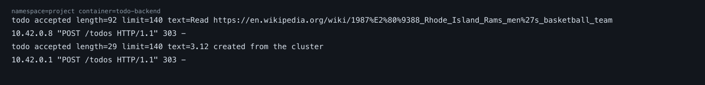

# The project

The todo application lives in this directory. Kustomize builds it from `kustomization.yaml`.

## Exercise 3.9 — DBaaS vs DIY

The chapter offers two ways to store the todos on Google Kubernetes Engine. DIY is a Postgres container plus a PersistentVolume. DBaaS is Cloud SQL for PostgreSQL, outside the cluster. The project uses DIY today: StatefulSet `postgres`, image `postgres:18.0`, one replica, a 100Mi volume, password in the Secret `postgres-auth`. Pods reach it at `postgres:5432` inside the namespace.

### Work to initialize

DIY is the manifests already in `todo-backend/manifests/postgres.yaml`. Apply creates the headless Service, the StatefulSet and the disk. No extra Google API, no VPC peering, no second product. A branch environment from exercise 3.7 gets its own database, because the StatefulSet is created in that namespace.

Cloud SQL starts with the SQL Admin API, a region, a machine tier and a disk, then the database `todos` and a user. Creating the instance takes minutes. The backend must stop using `PGHOST=postgres` and reach Cloud SQL through private services access or the Cloud SQL Auth Proxy. One shared instance mixes every branch. One instance per branch repeats the whole setup.

### Cost to initialize

DIY adds a persistent disk to a cluster that is already running. This database asks for 100Mi. There is no separate database machine, so an idle todo list does not start a new bill.

Cloud SQL is its own bill from the moment the instance exists: vCPU, memory and its own disk, including hours with no traffic. Backup storage and transaction logs add to that. A regional high-availability instance keeps a standby and costs more. For this application the instance costs more on day one than the disk under the Pod.

### Maintenance

DIY leaves the Postgres version, restarts and disk growth to us. The image tag is `postgres:18.0`. One replica means a node or disk failure is downtime until the Pod is scheduled again and the volume attaches. A zonal disk does not fail over by itself. A full disk is our alert.

Cloud SQL applies minor patches inside a maintenance window. High availability is the `REGIONAL` setting, with failover, rather than a second StatefulSet. Schema changes, users and database flags stay ours. A major version upgrade is still a decision we make, and it restarts the instance. Turning point-in-time recovery on or off restarts it too.

### Backups

DIY has no saved backup in this project. The earlier `pg_dump` Job produced a dump and did not store it. A useful backup is a CronJob that runs `pg_dump` and uploads the file. Restore is download plus `psql`, and we have to test it. A GKE disk snapshot is fewer steps. A snapshot of Postgres while it is writing can be inconsistent. We own that pipeline.

Cloud SQL takes automated backups every day. On an Enterprise instance created in the console they are kept for 7 days (15 days on Enterprise Plus). Retention can be set from 1 to 365 days. On-demand backups stay until we delete them. Point-in-time recovery replays write-ahead logs to a chosen time and creates a new instance. In the console it is on by default for Enterprise. With gcloud, Terraform or the Admin API it is off until we enable it. We do not write the restore script. The price is backup storage, and the first enable of point-in-time recovery restarts the instance.

Sources: [backup options](https://docs.cloud.google.com/sql/docs/postgres/backup-recovery/backup-options), [point-in-time recovery](https://docs.cloud.google.com/sql/docs/postgres/backup-recovery/configure-pitr), [restore](https://docs.cloud.google.com/sql/docs/postgres/backup-recovery/restore).

### For this project

DIY fits a single-replica todo list on a small cluster: the manifests exist, a branch gets its own database, and the extra cost is a small disk. Backups and failover remain work we still have to add.

Cloud SQL fits a database we do not want to operate. Daily backups, restore to a point in time and failover are settings. The setup and the always-on instance price are the reason to leave it for later.

## Exercise 3.10 — daily backup

CronJob `todo-backup` runs at 03:00 UTC. It dumps the database `todos` with `pg_dump` and uploads `todos/todos-<timestamp>.sql` to the bucket named in the ConfigMap `todo-backup-config`.

The image is `todo-backup:3.10`. The service-account key is the Secret `storage-sa-key`, mounted at `/var/secrets/google/key.json`. Create that Secret on the cluster. It is not in this repository, and the GitHub Action does not create it.

## Exercise 3.11 — requests and limits

Every container has requests and limits. On a local cluster `kubectl top pods -n project --containers` showed todo-app at 1m/12Mi, todo-backend at 3m/23Mi and postgres at 11m/30Mi, all inside their limits, with no restarts. A one-off read-wikipedia Job completed inside 50m/64Mi. The backup CronJob was not run, because its key is not on the cluster. Its limit is higher because the container runs `pg_dump` and the Storage client.

## Exercise 3.12 — logs for a new todo

GKE sends container stdout and stderr to Cloud Logging as resource `k8s_container`, log name `stdout`. Open the cluster Logs tab, or Workloads → `todo-backend` → Container logs. In Logs Explorer:

```text
resource.type="k8s_container"
resource.labels.cluster_name="dwk-cluster"
resource.labels.namespace_name="project"
resource.labels.container_name="todo-backend"
textPayload:"todo accepted"
```

The backend prints `todo accepted length=... text=...` for each stored todo. The picture is that stdout from the local cluster after creating `3.12 created from the cluster`. Monitoring was not enabled on a paid Google project. The same line is what GKE would store. See [View GKE logs](https://cloud.google.com/kubernetes-engine/docs/how-to/view-logs).



## Exercise 4.2 — health check

`GET /healthz` returns 200 `{"status":"ok"}` only when the in-memory flag is set and `SELECT 1` succeeds. `POST /break` clears the flag. The button on the todo page calls that route. Until `/healthz` is 200 again, the page is System Failure and reloads itself. The todos stay in Postgres.

The backend Deployment probes `/healthz`. The startup probe covers the wait for Postgres. The readiness probe removes the Pod from the Service. After three 500 responses, five seconds apart, the liveness probe restarts the container. The Pod keeps its name and `RESTARTS` increases. A new process starts with the flag set. See [configure liveness, readiness and startup probes](https://kubernetes.io/docs/tasks/configure-pod-container/configure-liveness-readiness-startup-probes/).

The process is PID 1, so it exits on `SIGTERM` instead of waiting out the 30 second grace period. Images are `todo-app:4.2` and `todo-backend:4.2`.

## Exercise 4.5 — done field

`GET /todos` returns objects `{"id", "todo", "done"}`. `PUT /todos/<id>` with `{"done": true}` or `{"done": false}` updates that row. An empty body sets `done` to true. A new todo is stored with `done` false. The column is added on startup when the table already exists.

The page shows `Mark done` on an open todo. The button posts to todo-app at `/done/<id>`, because an HTML form cannot send PUT. Todo-app then calls `PUT /todos/<id>` on the backend. A finished todo is struck through and labelled `Done`. Images are `todo-app:4.5` and `todo-backend:4.5`.
